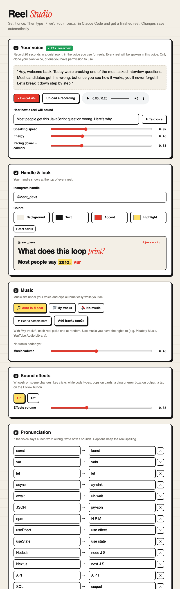

# Reel Studio — interview-prep reels from one line

Type a topic in Claude Code, get a finished Instagram reel in **your own voice**:

```
/reel Day 2 of JavaScript interview prep: hoisting
```

Claude writes the script, your cloned voice reads it, and code, diagrams, captions, music and sound effects are animated in sync. Out comes a 1080×1920 MP4, ready to post. Everything runs on your computer and costs nothing.

Built for tech interview content (JavaScript, React, system design, DSA, backend, behavioral), and easy to bend to any explainer.

## What you get

- 🎙️ **Your voice**: record 20 seconds once and every reel is spoken in it ([Chatterbox](https://github.com/resemble-ai/chatterbox) voice cloning, local)
- ⌨️ **Code that types itself**, with syntax colors, highlighted lines, and console output (errors in red)
- 🧩 **System-design diagrams** whose boxes and arrows appear exactly when you say them
- 🆚 **Comparisons, step lists, big takeaways**, and a Follow button that flips to Following
- 💬 **Word-by-word captions** matched to the real voice
- 🎵 **Music + sound effects**: a fresh lo-fi beat per reel that dips under your voice, plus whooshes, key clicks, pops, ding/buzz
- ✅ **Self-checking voice**: every sentence is transcribed back, and any take that skips words is re-recorded automatically
- 🎨 **Settings page**: voice, handle, colors, music, effects and pronunciations, no config files needed

## 🚀 Easy setup guide (one time, about 15 minutes)

No coding needed. Just copy and paste.

### Step 1: Install Claude Code
Get it from **[claude.com/claude-code](https://claude.com/claude-code)** and sign in. This is the app you'll type `/reel` into.

### Step 2: Open the terminal

| Windows | Mac |
|---|---|
| Press the **Windows key**, type **PowerShell**, press **Enter** | Press **Cmd + Space**, type **Terminal**, press **Enter** |

### Step 3: Paste one line and press Enter

**Windows:**
```powershell
irm https://raw.githubusercontent.com/AwaisZulfqar/reel-studio/main/install.ps1 | iex
```

**Mac:**
```bash
curl -fsSL https://raw.githubusercontent.com/AwaisZulfqar/reel-studio/main/install.sh | bash
```

It installs everything it needs on its own and shows the progress, `1/5` → `5/5`. The first time it downloads about 3.5 GB, so it takes 10–15 minutes. Wait until you see:

```
READY
```

> 💡 If Windows asks *"Do you want to allow this app to make changes?"*, click **Yes**.

### Step 4: Record your voice (20 seconds)
Open **Claude Code** and type:
```
/reel settings
```
A page opens in your browser. Click **● Record 20s** and read the text on the screen out loud. Then type your Instagram handle and pick your colors and music. Everything saves on its own.



> Other ways to open the settings page: double-click **`settings.cmd`** (Windows) or **`settings.command`** (Mac) in the `.claude/skills/reel` folder.

### Step 5: Make your first reel 🎬
In Claude Code, type:
```
/reel what is a closure in JavaScript
```
Wait about 5 minutes. Claude tells you where the video is saved, and it also shows up at the bottom of the settings page.

**That's it.** From now on it's only Step 5.

<details>
<summary>❓ Something went wrong? (click)</summary>

| Problem | Fix |
|---|---|
| `...isn't on PATH yet. Close this window...` | Close PowerShell, open a new one, paste the same line again. It continues where it stopped. |
| `running scripts is disabled on this system` | Paste this first, then the install line: `Set-ExecutionPolicy -Scope CurrentUser RemoteSigned` |
| `winget is not recognized` (Windows) | Update **App Installer** from the Microsoft Store, then try again. |
| Download stuck at the same % for minutes | Press **Ctrl + C**, paste the line again. It resumes. |
| `/reel` not found in Claude Code | Fully quit and reopen Claude Code. |
| Microphone doesn't record | Click the 🔒 next to the address bar → allow **Microphone**. Or upload a voice memo instead. |
| Voice says a word wrong | Settings page → **Pronunciation** → add how it sounds (e.g. `const` → `konst`). |
| Anything else | Run the install line again; it's safe and also updates you to the newest version. Still stuck? [Open an issue](https://github.com/AwaisZulfqar/reel-studio/issues) and paste the error. |
</details>

<details>
<summary>🔧 What gets installed / manual install (click)</summary>

| Tool | Why | Windows | macOS |
|---|---|---|---|
| Git | download the skill | `winget install Git.Git` | `xcode-select --install` |
| ffmpeg | audio/video processing | `winget install Gyan.FFmpeg` | `brew install ffmpeg` |
| Node.js 18+ | video engine (Remotion) | `winget install OpenJS.NodeJS.LTS` | `brew install node` |
| uv | sets up Python 3.12 | `winget install astral-sh.uv` | auto-installed |
| Google Chrome | renders the frames | `winget install Google.Chrome` | [download](https://www.google.com/chrome/) |

Everything goes into `~/.claude/skills/reel` (Windows: `C:\Users\<you>\.claude\skills\reel`). Manual install: `git clone https://github.com/AwaisZulfqar/reel-studio ~/.claude/skills/reel`, then run `setup.ps1` (Windows: `powershell -ExecutionPolicy Bypass -File setup.ps1`) or `bash setup.sh` inside it. To uninstall, delete that folder.
</details>

## Use it

```
/reel what is a closure in JavaScript
/reel design a URL shortener
/reel SQL vs NoSQL, make it a quick comparison
/reel Day 5: debounce vs throttle, start with a search box example
```

Each reel takes about 5 minutes on an M1 Mac (voice ~3 min, video ~2 min) and lands in `jobs/<topic>/<topic>.mp4`. The settings page shows all your reels.

Not happy with something? Just say it: *"slower voice"*, *"change the hook"*, *"bigger code"*, *"music quieter"*. Voice clips are cached, so visual tweaks re-render in ~2 minutes.

## Settings

Everything lives in `config.json` (created from `config.example.json`). The settings page edits it for you.

| Setting | What it does |
|---|---|
| `handle` | Shown at the top of every reel |
| `speed`, `exaggeration`, `cfg` | Voice speed, energy and pacing |
| `music` | `"auto"` (generated lo-fi), `"music/"` (your tracks, random pick) or `null` |
| `musicVolume`, `sfx`, `sfxVolume` | Mix levels; turn effects on/off |
| `theme` | Background, text, accent and highlight colors |
| `pronounce` | How the voice should say tech words (`const` → `konst`); captions keep the real spelling |

## How it works

```
topic → Claude writes script.json → Chatterbox speaks each sentence in your voice
      → Whisper checks every word was said + times each word
      → sound.py mixes voice + ducked music + effects (synced to animations)
      → Remotion renders the scenes in Chrome → MP4
```

| File | Role |
|---|---|
| `SKILL.md` | Instructions Claude follows for `/reel` (script rules, scene types) |
| `make.py` | Pipeline: voice → timings → mix → render |
| `sound.py` | Music synth, sound effects, mixing |
| `video/src/` | Remotion scenes: hook, code, diagram, compare, list, big, cta |
| `ui.py`, `ui.html` | Settings page (Python standard library only) |
| `jobs/example/script.json` | A full example script |

You can also run it without Claude: write a `script.json` like the example and run `.venv/bin/python make.py jobs/<name>/script.json`.

## Platform notes

- **macOS (Apple Silicon)**: tested on M1, uses the GPU for the voice.
- **Windows 10/11**: `install.ps1` / `setup.ps1`. With an NVIDIA GPU, the CUDA build of PyTorch is installed automatically. Without one, the voice runs on the CPU and a reel takes noticeably longer (roughly 10–20 min).
- **Linux**: `install.sh`; install ffmpeg, node and Chrome/Chromium with your package manager first. CUDA is used if available.

## Licenses and fair use

- This project: MIT (see `LICENSE`).
- [Remotion](https://remotion.dev/license) is free for individuals and companies of up to 3 people; larger companies need a Remotion company license.
- [Chatterbox](https://github.com/resemble-ai/chatterbox) (MIT) adds an inaudible watermark to generated speech.
- Fonts (Inter, JetBrains Mono, Instrument Serif) are under the SIL Open Font License.
- **Only clone your own voice, or a voice you have explicit permission to use.**
- Add only music you have the rights to. The built-in beat is generated locally and is yours to use.
